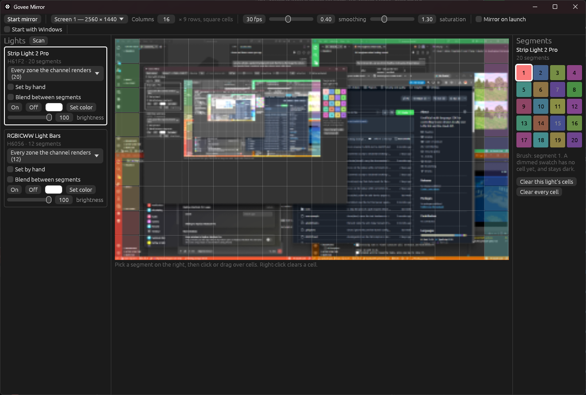
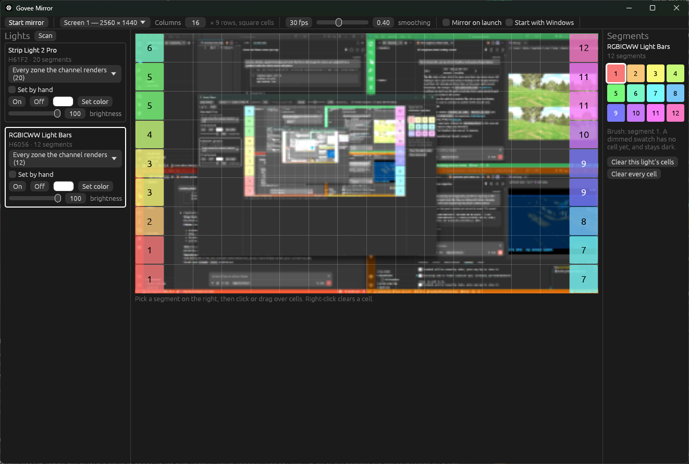

# Govee Razer Mirror Windows 11 PC

A replacement for DreamView on Windows. I got sick of the Govee app, so this
mirrors the screen onto Govee lights straight over your own network: no
account, no cloud, no phone. It also drives the Razer Wired ARGB Controller
over USB, with no Synapse.

## Features

- **Screen mirror.** A grid of square cells covers the screen, and you paint
  each cell onto the segments of your lights. One cell can feed several
  lights, and a segment that several cells feed takes their average.
- **Box fill.** Draw a box over the cells and type a range, such as 1 to 60:
  the segments spread across the box with no gap. 60 to 1 runs the other
  way.
- **Razer Wired ARGB Controller.** Each port is a light, and each LED a
  segment. It runs over USB with Synapse closed, and Exit hands the LEDs
  back to the controller's own effect.
- **Profiles.** Keep several setups, and link a program to one: while that
  program runs, the app switches to its profile. The process list is read
  every 5 seconds, and only while a profile names a program.
- **Resolution per light.** Mirror at the light's finest count, or at a
  segment count set by hand.
- **More segments than the Govee app.** It drives every zone the light's
  segment channel renders: 20 on the H61F2 strip, where the app shows 10.
- **Segment palette.** Each light's segments show as numbered swatches, one
  color each. A click on a swatch blinks that segment white on the real
  light, so you see where it is.
- **Lights found on their own.** Every Govee light on the network with "LAN
  Control" enabled shows up, with power, brightness and color controls.
- **Patterns.** Rainbow rings, a color wheel of 12 solid wedges, or a spiral,
  in place of the screen. Each one moves or holds still.
- **Solid colors.** A saturation setting pushes averaged colors away from
  grey, and smoothing calms them over time.
- **Blend between segments.** The light fades from one segment to the next,
  where you turn it on.
- **Lives in the tray.** Closing the window keeps the mirror on, in the
  notification area. Right-click the icon to show the window, start or stop
  the mirror, turn start with Windows off, or exit.
- **Starts on its own.** Start with Windows, in the tray, and start the mirror
  on launch.
- **Light on the machine.** The GPU shrinks the screen and about 256 pixels
  come back per frame. A screen that does not change costs nothing.
- **One file.** `govee-mirror-pc.exe` runs on Windows 10 and 11 with nothing
  else to install.





## Get it

Download `govee-mirror-pc.exe` from the
[releases page](https://github.com/Replica-/govee-mirror/releases) and run it.
Close Govee Desktop first: only one program can take the port the lights
answer on.

To build it yourself, install Rust with the MSVC toolchain, then:

```sh
cd apps/mirror
cargo run --release
```

The app's own page is [`apps/mirror/README.md`](apps/mirror/README.md).

## Lights measured for this

A light mirrors segment by segment where its device file gives it the
segment channel over `lan`. These two were measured for this app, on one unit
each:

| Model | Name | Segments in the Govee app | Segments here |
| ----- | ---- | ------------------------- | ------------- |
| H61F2 | Strip Light 2 Pro | 10 | 20 |
| H6056 | RGBICWW Light Bars | 6 | 12, 6 per bar |

The other models of [`docs/compatibility.md`](docs/compatibility.md) that
reach segments over `lan` mirror the same way. Any other light on Govee's LAN
list mirrors as one color.

## Built on Govee Toolkit

Govee Razer Mirror Windows 11 PC is a fork of
[Govee Toolkit](https://github.com/damient/govee-toolkit). The toolkit
implements the protocol, and the app calls it directly. What follows is the
toolkit's own description.

---

## Govee Toolkit

Your lights live on your network, and your commands stay there with them. Wi-Fi
or a Bluetooth link is all the toolkit needs, straight from your own machine.
The cloud waits as a third mode for the days you are away. And the toolkit
sends commands you have never seen before: the undocumented ones, read off the
wire.

[](docs/roadmap.md)
[](LICENSE)
[](https://github.com/damient/govee-toolkit/actions/workflows/ci.yml?query=branch%3Amain)

[](https://crates.io/crates/govee-toolkit)
[](https://crates.io/crates/govee-toolkit-cli)
[](https://crates.io/crates/govee-toolkit-dmx)
[](https://pypi.org/project/govee-toolkit/)
[](https://www.npmjs.com/package/govee-toolkit)
[](https://www.npmjs.com/package/govee-toolkit-mcp)

<!-- TODO: demo GIF here — a strip running per-segment colors. -->

## What it does

- Switch a device on and off, and set the brightness, the color and the white
  temperature.
- Address every segment of a strip on its own, not only the preset effects.
- Drive a strip frame by frame in real time: music reactive, screen ambilight,
  or your own source.
- Light one device at a time, so you see which identity drives which fixture
  in the room.
- Put a device out of the box on your Wi-Fi over Bluetooth, which is what makes
  it reachable over `lan`.

A command travels over your Wi-Fi (`lan`), over Bluetooth (`ble`) or through
Govee's servers (`cloud`). You choose which modes to allow, per device. One
allowed mode means one mode: an unreachable device fails with an error rather
than taking a slower path in silence.

<br>

<p align="center">
  <a href="https://gvetk.com/docs/start/"></a>
  <a href="https://gvetk.com/devices/"></a>
  <a href="https://gvetk.com/docs/modes/"></a>
  <a href="https://gvetk.com/docs/reference/"></a>
  <a href="devices/README.md"></a>
</p>

## Where the project is

The engine works over `lan`, over `ble` and over `cloud`, verified on real
hardware: discovery, on/off, brightness, color, per-segment color, and live
animation over the two local modes. It is usable today from Rust, from Python
and from Node.js.

A DMX bridge drives the same devices from a lighting desk:
`govee-toolkit-dmx` receives DMX on the network. Art-Net carries the DMX in.
See [`docs/dmx.md`](docs/dmx.md).

An MCP server, `govee-toolkit-mcp`, lets an AI assistant on your machine read
the device catalog and drive the lights. See
[the MCP guide](https://gvetk.com/docs/mcp/).

Next come a desktop app, then Home Assistant, Homebridge and Matter.
[`docs/roadmap.md`](docs/roadmap.md) tracks the order.

## Contributing

The protocol is implemented once, in Rust; Python and Node.js bind to that core.
Command names, byte layouts and measured limits live in
[`devices/`](devices/), never in code, so adding a model is editing one file.
[`docs/architecture.md`](docs/architecture.md) explains the shape of the code,
and [`CONTRIBUTING.md`](CONTRIBUTING.md) covers how to document a newly
discovered command.

Confirming whether your model works needs no code:
[`devices/README.md`](devices/README.md) walks through it.

## Legal notice

The "Govee" trademark is used descriptively only, to identify compatible
devices. This project is not affiliated with, sponsored by, or endorsed by
Govee.

## License

[MIT](LICENSE)
