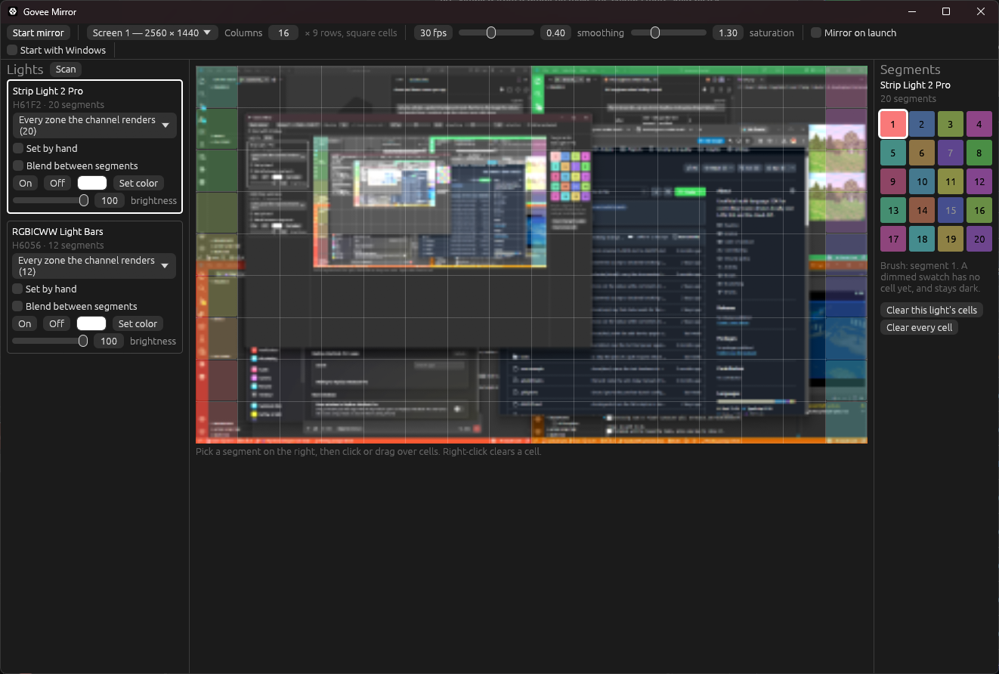
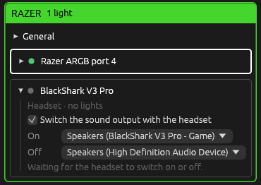

# Govee Razer Mirror Windows 11 PC

A replacement for DreamView on Windows, written because I got sick of the
Govee app. It mirrors the screen onto Govee lights over `lan`: a grid of
square cells covers the screen, and each cell feeds one segment of one light.
The features are listed at the top of the
[repository README](../../README.md#features).




The app calls the `govee-toolkit` crate directly. It is one executable, and it
carries the device catalog.

## Requirements

- Windows 10 or 11.
- "LAN Control" enabled for each light in the Govee Home app, and the light on
  the same network as the computer.
- Govee Desktop closed. It holds port 4002, which the lights answer on, and
  only one program can hold it.
- To build: the Rust toolchain for `x86_64-pc-windows-msvc`, with the Visual
  Studio C++ build tools.

## Get it

Download `govee-mirror-pc.exe` from the releases page of the repository. A
`mirror-vX.Y.Z` tag builds it on Windows and attaches it to the release.

To build it yourself:

```sh
cd apps/mirror
cargo run --release
```

The executable is `target/release/govee-mirror-pc.exe`. In VS Code, the "Govee Razer Mirror Windows 11 PC" configurations in
`.vscode/launch.json` build and start the app.

## Use

1. Choose the screen and the number of columns in the top bar. The rows
   follow from the shape of the screen, so that every cell is square.
2. Click a light on the left. The lights sit in a section per brand, and
   each card opens with its arrow. The light's segments show on the right,
   one numbered swatch each.
3. Click a swatch. It becomes the brush, and that segment blinks white on the
   light 4 times. Then the light goes back to what it showed.
4. Click or drag over cells to give them that segment. Right-click or drag to
   clear cells.
5. Press **Start mirror**.

Under the button, the app shows the frame rate that the mirror reaches, and
the share of CPU and GPU that it uses, as Task Manager counts them.

A segment that several cells feed takes their average. A dimmed swatch is a
segment that no cell feeds: it stays dark while the mirror runs.

## The tray

The app keeps an icon in the notification area, next to the clock. Closing
the window hides it there, and the mirror carries on. Click the icon to show
the window. Right-click it for the menu:

- **Show**: the window.
- **Start mirror** and **Stop mirror**.
- **Start with Windows**: ticked while the app starts at sign-in. Click it to
  turn that off or on.
- **Exit**: stops the mirror, so that each light goes back to the color it
  held, and ends the app.

## Box fill

Switch **Tool** to **Box** in the right panel, and drag a box over the
cells. Type a range of the chosen light's segments and press **Fill box**:

- **1 to 60** runs left to right, or top to bottom for a box taller than it
  is wide. **60 to 1** runs the other way.
- With more segments than columns, each column drives a run of segments,
  such as 1–3, 4–7, and the range is covered with no gap.
- With fewer, each column drives one segment.

**Clear box** takes the chosen light out of the box. A cell feeds one run of
each light that paints it, so the other lights in the box keep theirs.

## Profiles

A profile holds a whole setup: the screen, the grid, the cells, each light's
resolution and blend, the source, the saturation, smoothing and rate, and
the key and LED effects of the Razer keyboard and mousepad. The Razer port
counts, the headset switch, the macro keys and **Mirror on launch** are
shared by every profile.

In the row under the top bar, pick a profile, or press **New** for a copy of
this one. A profile can name a program, such as `game.exe`: while it runs,
the app switches to that profile, and it switches back to the one you picked
when the program ends. The process list is read every 5 seconds, and only
while a profile names a program.

## Razer Wired ARGB Controller

The app drives the Razer Wired ARGB Controller (Razer Chroma Addressable RGB
Controller) over USB. Synapse must be closed: it sends frames of its own,
and the app warns after a scan when it runs.

- Open **General** in the **Razer** section, and set the LED count of each
  port as Synapse set it. A port with 0 is left out.
- Each port with LEDs is a light, and each LED a segment. **Set by hand**
  groups the LEDs into fewer segments.
- The LEDs follow the mirror while it runs. Stopping the mirror, or Exit,
  hands them back to the controller's own effect.
- **brightness** on a port card, or **brightness, all** in **General**,
  scales the colors that the mirror sends to the port. The controller takes
  no brightness command, so the setting applies while the mirror runs.

## Sound reaction

Turn on **Sound reaction** under the screen. A spectrum of the sound that
Windows plays shows there, and the orange bars are the bands that a hit is
read from. Beside the spectrum, tick **Reacts** for each light that must
follow the sound. The other lights keep the mirror's colors as they are.

- When a hit comes, each reacting light goes to its **On bass** level. It
  then falls back to its **At rest** level over the **Fade** time. The two
  levels are in percent: 50 and 100 by default.
- **Adaptive** finds a hit as a jump above the average of the last second or
  so. It follows each song and the volume. **Sensitivity** sets how small a
  jump counts. The yellow line shows the level a hit must reach now.
- **Fixed line** finds a hit as any level above the yellow line. Drag on the
  spectrum to move it. A bass that stays above the line holds the light at
  its peak.
- **Kick (40–100 Hz)** reads the kick drum, with less of the bass line.
  **All bass (below 150 Hz)** reads every band below 150 Hz.
- **Fade** from 150 to 300 ms shows each hit. A shorter fade can end before
  the light shows the hit.
- A light that reacts shows an orange **SOUND** tag before its name.
- The levels scale the colors of the mirror, so the lights react while the
  mirror runs. A Govee light's own brightness still applies under them.
- The app listens to the default output, and follows it when it changes.

## Razer headset sound switch

The BlackShark V3 Pro has a card of its own in the **Razer** section. With
the switch on, Windows plays sound on the headset while it is on, and on
another output while it is off.



- Unfold the **BlackShark V3 Pro** card and turn on **Switch the sound output
  with the headset**.
- **On** is the output that plays while the headset is on, such as
  "Speakers (BlackShark V3 Pro - Game)".
- **Off** is the output that plays while it is off. It starts as the output
  that played when you turned the switch on.
- **Show a notification at each switch** shows a Windows notification,
  "Headset on" or "Headset off", with the output that now plays. It is on
  by default.

The USB dongle stays plugged in, so Windows keeps the headset's outputs
listed while the headset is off. The app reads the connection from the
dongle instead. Synapse can stay open.

- The switch applies at the next time the headset turns on or off. The
  dongle reports a change, not the state, so a headset that is already on
  when the app starts keeps the current output.
- When the headset turns off, the app switches back only if the headset's
  output still plays. An output that you picked by hand meanwhile stays.
- The switch sets the default output for every role: playback and
  communications.

## Razer key and LED effects

The Huntsman V2 keyboard (full size, ANSI) and the Strider Chroma mousepad
each have a card of their own in the **Razer** section. They do not mirror
the screen: the app draws an effect on each group of keys or LEDs. The
mousepad has 19 LEDs up its left edge.

- Unfold the card, and pick what the lights show: **Own effect** (the effect
  that the device keeps in its memory), **App effects**, or **Off** (every key
  or LED dark). Then press **Edit effects…**.
- **Add group**, then click or drag over the drawing to put keys or LEDs in
  the picked group. The right button takes them out. Each one is in one group
  at a time.
- Each group has an effect: **Static**, **Breathing**, **Spectrum**, **Wave**
  or **Starlight**, with a color and a speed where the effect takes one.
- On the mousepad, **Wave** runs up the strip.
- **Brightness** scales every key or LED. Those in no group are dark.

The drawing shows the colors that the device shows. The app sends a frame only
when a color changes, so static groups cost nothing while they hold. When you
turn the option off or exit the app, the device gets back the effect that it
keeps in its own memory. Both devices were tested with Synapse closed.

The effects belong to the profile in use, so two profiles can light the
devices in two ways.

### Macro keys

The three macro keys of the Huntsman V2 send nothing to Windows on their own.
In the keyboard card, give a key a profile: a press switches to that profile,
as a pick in the profile row does. For example, one key picks a profile with
the effects, and another picks a copy of it with the keyboard and mousepad
**Off**.

While a key has a profile, the app holds the keyboard in driver mode, which
makes the macro keys report to it. The other keys, the Fn keys and the dial
work as before. When the app exits, the keyboard goes back to normal mode.

## Settings

| Setting | Where | What it does |
| ------- | ----- | ------------ |
| Columns | Top bar | The width of the grid. The rows follow. |
| fps | Top bar | How often the screen is sampled. Each light sends at the rate its device file measured, and only the newest frame goes out. |
| Smoothing | Top bar | The share of the previous frame that stays, from 0 to 0.95. Higher is calmer and slower. |
| Saturation | Top bar | How far each color moves away from grey, from 1 to 2. Averaging a patch of screen pulls colors toward grey, and this gives solid colors back. 1.3 by default. |
| Source | Top bar | What the lights mirror: the **Screen**, or a pattern drawn on the grid. **Rings** are rainbow rings around the center. **Color wheel** is 12 solid wedges, clockwise from yellow-green at 12 o'clock. **Spiral** twists those wedges half a turn from the center to a corner. Each cell feeds its segment as it does from the screen. |
| Moving | Top bar | Whether a pattern moves: the rings move outward, and the wheel and the spiral turn clockwise. **Speed** sets how many rings or wedges pass in a second. A pattern that does not move holds still on the lights. |
| Mirror on launch | Top bar | Starts the mirror once the first scan finds the lights. |
| Start with Windows | Top bar, and the tray menu | Starts the app in the notification area when you sign in. Clear it to remove the entry. |
| Resolution | Each light | The segment count: as the Govee app shows it, every zone the segment channel renders, or one per LED where the device file measured that. The finest is the default. |
| Set by hand | Each light | A segment count of your own, up to what the channel renders. |
| Blend between segments | Each light | The light fades from one segment to the next instead of hard blocks. On a Govee light, the firmware also wraps from the last segment back to the first. On a Razer port, the app computes the fade; with one segment per LED, each LED takes the mean of its color and the colors next to it. |
| Light addresses | The IP box and **Add** beside **Scan**; the list with **Remove** in **General** of the Govee section | IP addresses that each scan also asks directly. Add a light there when the scan does not find it: some routers drop the multicast scan. The list applies to every profile. |
| Saved lights | The list with **Forget** in **General** of the Govee section | Each Govee light that a scan found, with the address it answered at. Each scan asks these addresses directly, so a light that the multicast scan misses comes back with its settings. **not found** marks a light that the last scan did not reach. The list applies to every profile. |
| On, Off, color, brightness | Each Govee light, and **General** in the Govee section for every light at once | The general brightness is a percent of each light's own range. |
| brightness | Each Razer port, and **General** in the Razer section for every port at once | Scales the colors that the mirror sends to the port. |
| Sound reaction, detection, sensitivity, band, Fade | Under the screen | See [Sound reaction](#sound-reaction). |
| Reacts, At rest, On bass | Beside the spectrum, per light | Whether the light follows the sound, and its two levels in percent. Off by default. |

While the mirror runs, the power and color buttons are off: a power command
ends the segment channel on some models. Brightness stays available.

## What each light reaches

| Light | Segments | Path |
| ----- | -------- | ---- |
| A model whose device file gives `segments` over `lan` | The counts in the device file | The segment channel, `docs/protocol/lan.md` 2.3 |
| Any other model that answers the `lan` scan | 1: the whole light | The `color` command. It waits for the light, so it is slower than the segment channel. |

## How the capture works

DXGI Desktop Duplication hands over the screen as a GPU texture. The GPU
shrinks it with its mipmap chain, and a copy about 256 pixels wide comes back
to the CPU. A screen that does not change delivers no frame. An HDR screen is
captured in 8 bits per channel. The capture runs at the mirror rate while
the mirror reads the screen, and at 10 frames per second while only the
window preview needs it. With neither, it stops and releases the screen. `src/capture/dxgi.rs` is the one module with
`unsafe` code: every Direct3D call is a COM call.

## Files

- `%APPDATA%\govee-toolkit\mirror.json`: the settings, the grid and the
  assignments. A file that does not parse is moved to `mirror.json.bad`, and
  the app starts from the defaults.
- `%APPDATA%\govee-toolkit\mirror-crash.log`: what a crash reported. The
  release build has no console.

The modes of each light come from the configuration file of the toolkit, as
for the CLI.
