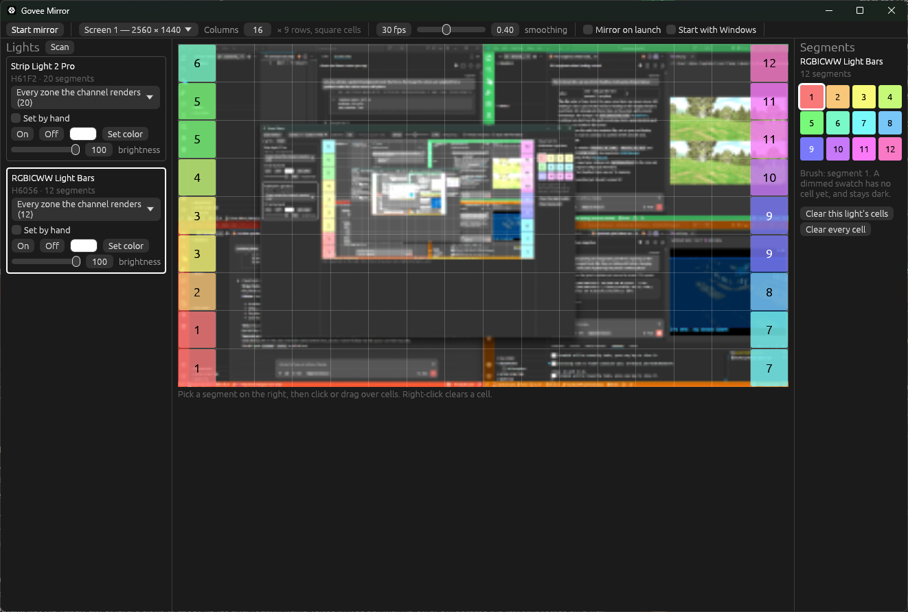

# govee-mirror-pc

A replacement for DreamView on Windows, written because I got sick of the
Govee app. It mirrors the screen onto Govee lights over `lan`: a grid of
square cells covers the screen, and each cell feeds one segment of one light.
The features are listed at the top of the
[repository README](../../README.md#features).




The app calls the `govee-toolkit` crate directly. It is one executable, and it
carries the device catalog.

## Requirements

- Windows 10 or 11.
- "LAN Control" enabled for each light in the Govee Home app, and the light on
  the same network as the computer.
- Govee Desktop closed. It holds port 4002, which the lights answer on, and
  only one program can hold it.
- To build: the Rust toolchain for `x86_64-pc-windows-msvc`, with the Visual
  Studio C++ build tools.

## Get it

Download `govee-mirror-pc.exe` from the releases page of the repository. A
`mirror-vX.Y.Z` tag builds it on Windows and attaches it to the release.

To build it yourself:

```sh
cd apps/mirror
cargo run --release
```

The executable is `target/release/govee-mirror-pc.exe`. In VS Code, the "Govee
Mirror PC" configurations in `.vscode/launch.json` build and start the app.

## Use

1. Choose the screen and the number of columns in the top bar. The rows
   follow from the shape of the screen, so that every cell is square.
2. Click a light on the left. Its segments show on the right, one numbered
   swatch each.
3. Click a swatch. It becomes the brush, and that segment blinks white on the
   light 4 times. Then the light goes back to what it showed.
4. Click or drag over cells to give them that segment. Right-click or drag to
   clear cells.
5. Press **Start mirror**.

A segment that several cells feed takes their average. A dimmed swatch is a
segment that no cell feeds: it stays dark while the mirror runs.

## The tray

The app keeps an icon in the notification area, next to the clock. Closing
the window hides it there, and the mirror carries on. Click the icon to show
the window. Right-click it for the menu:

- **Show**: the window.
- **Start mirror** and **Stop mirror**.
- **Start with Windows**: ticked while the app starts at sign-in. Click it to
  turn that off or on.
- **Exit**: stops the mirror, so that each light goes back to the color it
  held, and ends the app.

## Box fill

Switch **Tool** to **Box** in the right panel, and drag a box over the
cells. Type a range of the chosen light's segments and press **Fill box**:

- **1 to 60** runs left to right, or top to bottom for a box taller than it
  is wide. **60 to 1** runs the other way.
- With more segments than columns, each column drives a run of segments,
  such as 1–3, 4–7, and the range is covered with no gap.
- With fewer, each column drives one segment.

**Clear box** takes the chosen light out of the box. A cell feeds one run of
each light that paints it, so the other lights in the box keep theirs.

## Profiles

A profile holds a whole setup: the screen, the grid, the cells, each light's
resolution and blend, the source, and the saturation, smoothing and rate.
The Razer port counts and **Mirror on launch** are shared by every profile.

At the top of the left panel, pick a profile, or press **New** for a copy of
this one. A profile can name a program, such as `game.exe`: while it runs,
the app switches to that profile, and it switches back to the one you picked
when the program ends. The process list is read every 5 seconds, and only
while a profile names a program.

## Razer Wired ARGB Controller

The app drives the Razer Wired ARGB Controller (Razer Chroma Addressable RGB
Controller) over USB. Synapse must be closed: it sends frames of its own,
and the app warns after a scan when it runs.

- In the **Razer ARGB controller** box below the lights, set the LED count
  of each port as Synapse set it. A port with 0 is left out.
- Each port with LEDs is a light, and each LED a segment. **Set by hand**
  groups the LEDs into fewer segments.
- The LEDs follow the mirror while it runs. Stopping the mirror, or Exit,
  hands them back to the controller's own effect.

## Settings

| Setting | Where | What it does |
| ------- | ----- | ------------ |
| Columns | Top bar | The width of the grid. The rows follow. |
| fps | Top bar | How often the screen is sampled. Each light sends at the rate its device file measured, and only the newest frame goes out. |
| Smoothing | Top bar | The share of the previous frame that stays, from 0 to 0.95. Higher is calmer and slower. |
| Saturation | Top bar | How far each color moves away from grey, from 1 to 2. Averaging a patch of screen pulls colors toward grey, and this gives solid colors back. 1.3 by default. |
| Source | Top bar | What the lights mirror: the **Screen**, or a pattern drawn on the grid. **Rings** are rainbow rings around the center. **Color wheel** is 12 solid wedges, clockwise from yellow-green at 12 o'clock. **Spiral** twists those wedges half a turn from the center to a corner. Each cell feeds its segment as it does from the screen. |
| Moving | Top bar | Whether a pattern moves: the rings move outward, and the wheel and the spiral turn clockwise. **Speed** sets how many rings or wedges pass in a second. A pattern that does not move holds still on the lights. |
| Mirror on launch | Top bar | Starts the mirror once the first scan finds the lights. |
| Start with Windows | Top bar, and the tray menu | Starts the app in the notification area when you sign in. Clear it to remove the entry. |
| Resolution | Each light | The segment count: as the Govee app shows it, every zone the segment channel renders, or one per LED where the device file measured that. The finest is the default. |
| Set by hand | Each light | A segment count of your own, up to what the channel renders. |
| Blend between segments | Each light | The light fades from one segment to the next instead of hard blocks. The firmware also wraps from the last segment back to the first. |

While the mirror runs, the power and color buttons are off: a power command
ends the segment channel on some models. Brightness stays available.

## What each light reaches

| Light | Segments | Path |
| ----- | -------- | ---- |
| A model whose device file gives `segments` over `lan` | The counts in the device file | The segment channel, `docs/protocol/lan.md` 2.3 |
| Any other model that answers the `lan` scan | 1: the whole light | The `color` command. It waits for the light, so it is slower than the segment channel. |

## How the capture works

DXGI Desktop Duplication hands over the screen as a GPU texture. The GPU
shrinks it with its mipmap chain, and a copy about 256 pixels wide comes back
to the CPU. A screen that does not change delivers no frame. An HDR screen is
captured in 8 bits per channel. `src/capture/dxgi.rs` is the one module with
`unsafe` code: every Direct3D call is a COM call.

## Files

- `%APPDATA%\govee-toolkit\mirror.json`: the settings, the grid and the
  assignments. A file that does not parse is moved to `mirror.json.bad`, and
  the app starts from the defaults.
- `%APPDATA%\govee-toolkit\mirror-crash.log`: what a crash reported. The
  release build has no console.

The modes of each light come from the configuration file of the toolkit, as
for the CLI.
